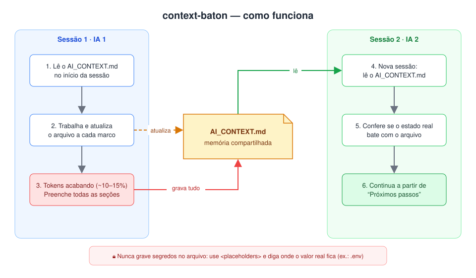

# 🏃‍♂️ context-baton

**🇧🇷 Português** · [🇺🇸 English](#-english)

---

## 🇧🇷 Português

> Template de handoff entre IAs: quando os tokens acabam, a IA despeja todo o contexto num arquivo e a próxima continua de onde parou.

### O problema

Assistentes de IA têm limite de contexto. Quando os tokens estão acabando, tudo o que a IA aprendeu sobre o seu projeto (decisões, erros, estado atual, próximos passos) se perde. A próxima sessão começa do zero.

### A solução

Um único arquivo Markdown, **`AI_CONTEXT.md`**, funciona como memória compartilhada entre sessões. A IA o lê no início e o preenche antes de acabar os tokens. A próxima IA lê e continua.

> Diagrama editável em [`docs/diagrama.drawio`](docs/diagrama.drawio) (abra em [app.diagrams.net](https://app.diagrams.net)).

### O que tem aqui

| Arquivo | Descrição |
|---------|-----------|
| `AI_CONTEXT.md` | Template vazio em português |
| `AI_CONTEXT.en.md` | Template vazio em inglês |

O template cobre: objetivo, stack, estrutura de arquivos, decisões, modelo de dados, regras de negócio, o que está feito, o que está em andamento, próximos passos, problemas conhecidos, perguntas em aberto e log de sessões.

### Como usar

1. Copie `AI_CONTEXT.md` (ou `AI_CONTEXT.en.md`) para a raiz do seu projeto.
2. Diga à IA, no início de cada sessão:
   > Leia o `AI_CONTEXT.md` antes de qualquer ação. Atualize-o a cada marco concluído e, quando os tokens estiverem acabando, preencha todas as seções para que outra IA possa continuar.
3. Quando uma sessão acabar, abra uma nova e peça para ler o arquivo. Ela continua do ponto em que a anterior parou.

Dica: se a sua ferramenta suporta um arquivo de instruções fixo (como `CLAUDE.md`), coloque essa instrução nele para não precisar repetir.

### 🔒 Segurança

O template instrui a IA a **nunca** gravar segredos no arquivo: senhas, tokens, chaves de API, IDs de cliente OAuth, dados pessoais ou caminhos com nome de usuário. Ela usa `<placeholders>` e indica onde o valor real fica (por exemplo, no `.env`).

Mesmo assim, **revise o arquivo antes de fazer commit** em um repositório público.

### Contribuindo

Sugestões e pull requests são bem-vindos: novas seções, exemplos preenchidos, traduções.

---

## 🇺🇸 English

> AI-to-AI context handoff template: when tokens run out, the AI dumps its full context into a file and the next one picks up exactly where it left off.

### The problem

AI assistants have a context limit. When tokens are running low, everything the AI learned about your project (decisions, mistakes, current state, next steps) is lost. The next session starts from scratch.

### The solution

A single Markdown file, **`AI_CONTEXT.md`**, acts as shared memory between sessions. The AI reads it at the start and fills it in before running out of tokens. The next AI reads it and carries on.

> Editable diagram at [`docs/diagrama.drawio`](docs/diagrama.drawio) (open it in [app.diagrams.net](https://app.diagrams.net)). Labels are in Portuguese.

### What's inside

| File | Description |
|------|-------------|
| `AI_CONTEXT.md` | Empty template in Portuguese |
| `AI_CONTEXT.en.md` | Empty template in English |

The template covers: goal, stack, file structure, decisions, data model, business rules, what's done, what's in progress, next steps, known problems, open questions and a session log.

### How to use

1. Copy `AI_CONTEXT.en.md` (or `AI_CONTEXT.md`) to the root of your project.
2. Tell the AI at the start of every session:
   > Read `AI_CONTEXT.md` before doing anything. Update it at every milestone, and when tokens are running low, fill in every section so another AI can continue.
3. When a session ends, open a new one and ask it to read the file. It resumes from where the previous one stopped.

Tip: if your tool supports a persistent instructions file (like `CLAUDE.md`), put that instruction there so you don't have to repeat it.

### 🔒 Security

The template tells the AI to **never** write secrets into the file: passwords, tokens, API keys, OAuth client IDs, personal data or paths containing a username. It uses `<placeholders>` and points to where the real value lives (e.g. in `.env`).

Still, **review the file before committing** to a public repository.

### Contributing

Suggestions and pull requests are welcome: new sections, filled-in examples, translations.
